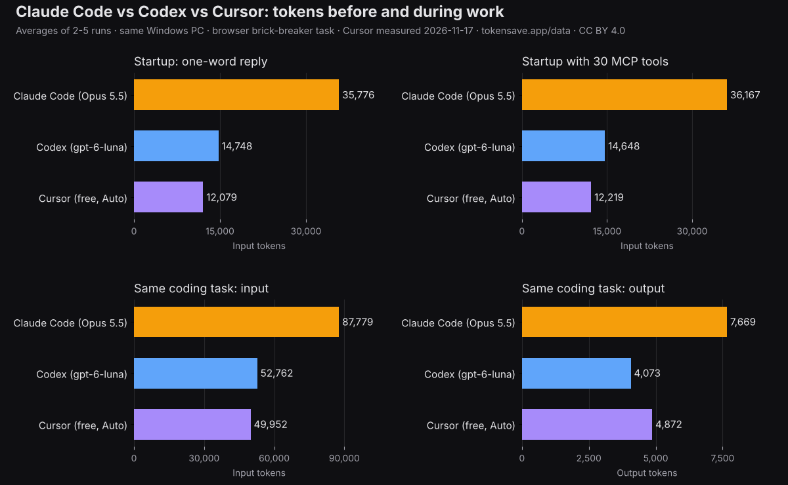

# Claude Code vs Codex vs Cursor: startup tokens, MCP tools and the same coding task

Input tokens Claude Code, Codex and Cursor use before doing any work, what adding 1 to 30 MCP tools adds, and tokens, time and output for the same browser-game task at medium effort.

**Headline:** a one-word reply costs 35,776 input tokens in Claude Code (Opus 5.5), 14,748 in Codex (gpt-6-luna) and 12,079 in Cursor (free plan, Auto). On the same coding task Codex used 40% fewer input tokens than Claude Code and Cursor 43% fewer. Adding 30 MCP tools barely changed any of them.

- Source page, chart and method: https://tokensave.app/data/claude-code-vs-codex-tokens
- Related: Claude effort levels (https://tokensave.app/data/claude-effort-cost)
- DOI (Zenodo): [10.5281/zenodo.23448342](https://doi.org/10.5281/zenodo.23448342)
- Also on: [Hugging Face](https://huggingface.co/datasets/JOHNISKING/claude-code-vs-codex-tokens) · [Kaggle](https://www.kaggle.com/datasets/johnisking/claude-code-vs-codex-startup-and-task-tokens)
- Measured: 2026-10-18 and 2026-10-22 (Claude Code and Codex: 4 startup and 5 task runs each); 2026-11-17 (v3, Cursor: 2 startup runs per tool count and 2 task runs)
- License: CC BY 4.0

## Key findings

- Claude Code starts 143% heavier than Codex and 196% heavier than Cursor: 35,776 vs 14,748 vs 12,079 input tokens for a one-word reply. That fixed amount is sent with every request (mostly cached).
- Adding MCP tools barely changed startup tokens. The full definitions of our 30 test tools are 4,541 tokens, but adding them raised Claude Code by 391 tokens (about 13 per tool), Codex by nothing measurable and Cursor by 140. All three load a tool's details only when needed.
- Using the tools is what costs: asked to list the 10 test tools and call one, Codex used 47,876 input tokens (+225% over its plain startup).
- Same task, fewer tokens on Codex and Cursor: Claude Code averaged 87,779 input and 7,669 output tokens (62 s, $0.39 at API prices); Codex 52,762 input and 4,073 output tokens (56 s); Cursor 49,952 input and 4,872 output tokens (78 s). All 12 games worked.
- Claude Code and Cursor wrote similar-length files: 474 and 448 lines on average, vs 58 for Codex, which wrote denser code.

## Files

- `claude-code-vs-codex-tokens.csv`: one row per run with `test` (`startup` or `same_task`), `tool`, `model`, `mcp_tools`, `run`, `input_tokens`, `cached_input_tokens`, `output_tokens`, `seconds`, `api_cost_usd`, `file_lines`
- `claude-code-vs-codex-tokens.json`: the same data plus prompts and setup
- `mcp_dummy.js`: the test MCP server (`node mcp_dummy.js <number_of_tools>`)
- `cursor_v2/`: the 2026-11-17 Cursor runs as recorded (`base_n<tools>_r<run>/run.jsonl`, `task_r<run>.jsonl`, the two games in `task_r<run>/index.html`, `brick_deep_cursor.json` from the scripted player, `run_cursor_v2.ps1`). The Windows user name is replaced with `USER`.

## Startup tokens and MCP tools

Average of 4 runs for Claude Code and Codex, 2 for Cursor (2026-11-17). On 2026-10-18 the same Cursor version read 909 more tokens at every tool count, and its free limit stopped three of those eight runs.

| Setup | Claude Code (Opus 5.5) | Codex (gpt-6-luna) | Cursor (free, Auto) |
|---|---:|---:|---:|
| 0 MCP tools | 35,776 | 14,748 | 12,079 |
| 1 MCP tool | 35,792 (+16) | 14,648 (-100) | 12,097 (+18) |
| 10 MCP tools | 35,915 (+139) | 14,648 (-100) | 12,135 (+56) |
| 30 MCP tools | 36,167 (+391) | 14,648 (-100) | 12,219 (+140) |

## The same coding task

Prompt: "Make a brick-breaker game that runs in the browser as a single file named index.html in the current folder. It needs 2 levels, a score display and 3 lives, and it must be playable with the keyboard and the mouse. Write the file and finish."

| Run | Input tokens | Output tokens | Time | Lines | API cost |
|---|---:|---:|---:|---:|---:|
| Claude Code · run 1 | 123,666 | 8,537 | 73 s | 487 | $0.42 |
| Claude Code · run 2 | 79,213 | 7,870 | 63 s | 527 | $0.39 |
| Codex · run 1 | 47,954 | 2,872 | 33 s | 49 | – |
| Codex · run 2 | 48,815 | 3,803 | 41 s | 117 | – |
| Claude Code · run 3 (2026-10-22) | 79,316 | 7,897 | 62 s | 513 | $0.39 |
| Claude Code · run 4 | 77,868 | 6,595 | 52 s | 421 | $0.35 |
| Claude Code · run 5 | 78,830 | 7,447 | 60 s | 420 | $0.38 |
| Codex · run 3 (2026-10-22) | 70,704 | 7,118 | 75 s | 29 | – |
| Codex · run 4 | 48,362 | 3,468 | 72 s | 46 | – |
| Codex · run 5 | 47,975 | 3,103 | 57 s | 51 | – |
| Cursor · run 1 (2026-11-17) | 58,459 | 4,816 | 81 s | 460 | – |
| Cursor · run 2 | 41,446 | 4,928 | 75 s | 437 | – |

## Method

1. All three tools on the same Windows laptop, each run in its own empty folder.
2. Claude Code 2.1.295, default model Opus 5.5, Max plan: `claude -p --output-format json`, MCP servers only from `--mcp-config` with `--strict-mcp-config`; task at `--effort medium --permission-mode acceptEdits`. Input = input + cache creation + cache read tokens; cost is Claude Code's API-price figure.
3. Codex CLI 0.162, default model gpt-6-luna, ChatGPT plan: `codex exec --json`, reasoning effort low (startup) and medium (task); MCP server via `-c mcp_servers.…`. Input tokens include cached tokens; no price on a ChatGPT plan.
4. Cursor Agent CLI 2026.10.16, free Hobby plan, model Auto (no effort setting): `cursor-agent -p --output-format stream-json --trust`, with `--approve-mcps` and the server in `.cursor/mcp.json` for startup and `--force` for the task. Input = input + cache read tokens; no price on the free plan.
5. Every game was opened in a headless browser: no errors, two levels, score and three lives on screen. The two Cursor games were also played by a script: the score rose, level 2 was reached and lives went 3, 2, 1, 0.

## Limitations

- Four startup and five task runs for Claude Code and Codex, two of each for Cursor, one task. Cursor was measured a month after the others. One Claude Code task run took an extra step (123,666 input tokens) and one Codex run read 70,704.
- Default models and per-token prices differ (Cursor's Auto does not say which model it picked), so fewer tokens is not automatically cheaper.
- Startup tokens include each tool's installed skills and plugins on this machine.

## Citation

TokenSave (2026). Claude Code vs Codex vs Cursor: startup tokens, MCP tools and the same coding task [Data set]. Zenodo. https://doi.org/10.5281/zenodo.23448342

See your own Claude Code and Codex usage at [tokensave.app](https://tokensave.app/claude-code-usage).
