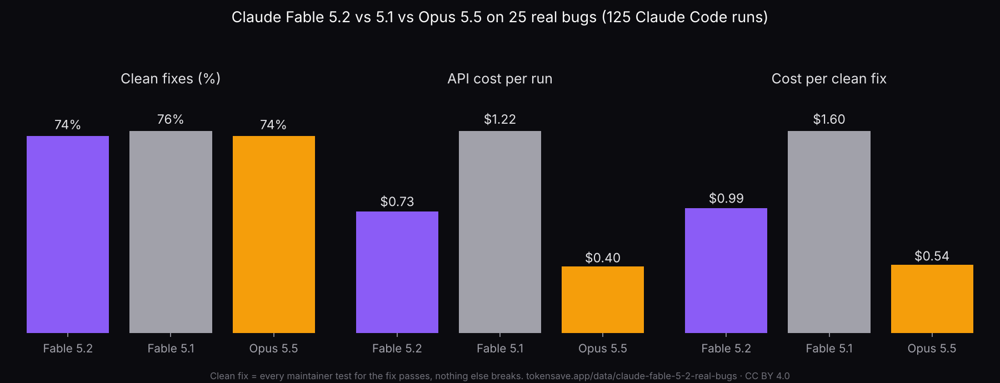

# Claude Fable 5.2 vs Fable 5.1 vs Opus 5.5 on 25 real bugs

125 pre-registered Claude Code runs (135 published) on the 25 real bugs of [dataset 25](../claude-real-bugs), scored by the maintainers' own tests.

Page with tables and method: https://tokensave.app/data/claude-fable-5-2-real-bugs

## Findings

- **Fable 5.2 cost 40% less per run than Fable 5.1** ($0.73 vs $1.22; 95% bug-level interval -50% to -27%), twice the 20% list-price cut. It wrote 27% fewer output tokens, read 67% less cache, took 14.6 turns instead of 21.0 and finished in a median 65 s instead of 136 s.
- **Fable 5.2 fixed exactly as many bugs as Opus 5.5:** 37 of 50 clean fixes each (difference 0 points, 95% interval -8 to +8; pre-registered threshold 15). Easy bugs 26/30 each, hard bugs 11/20 each.
- **Opus 5.5 was the cheapest per fix:** $0.54 per clean fix, against $0.99 for Fable 5.2 (+83% per run) and $1.60 for Fable 5.1.
- Fable 5.1 fixed 19 of 25 cleanly (1 run per bug).
- All three models missed the same four bugs (ct435, jy791, t336, z6496).

## Files

- `claude-fable-5-2-real-bugs.csv`: one row per run (round, bug, project, model, rep, in_design, cases passed/total, full fix, tests broken, clean fix, API cost, output, thinking and cache-read tokens, turns, seconds).
- `claude-fable-5-2-real-bugs.json`: the same runs plus the summary (arms, primary contrasts with bootstrap intervals, per-bug results).
- `runs/<model>_<bug>_r<n>/`: every run as recorded: `prompt.txt`, `run.jsonl` (stream-json log), `changes_raw.diff`, `status.txt`, `seconds.txt`, `err.txt`, new files under `untracked/`. The Windows user name is replaced with `USER`.
- `incidents/`: 8 attempts cut off by the 5-hour limit (6) or a desktop-app restart (2); not scored, re-run.
- `PREREG.md` (with amendment 1), `jobs.csv` (order after the amendment), `scripts/jobs_original.csv`, `scripts/run_f52.ps1` (runner), `scripts/score_all.sh` and `scripts/analyze29.py` (scoring with the unchanged dataset 25 scorers, and the analysis), `scripts/scores.jsonl`, `scripts/f52.log`.

## Method

- Bugs, starting folders, prompts and scorers from dataset 25: 15 easy and 10 hard bugs fixed upstream in August to October 2026 in 13 open-source projects, each run starting at the commit before the fix.
- Agent: Claude Code 2.1.322, headless `claude -p`, `--effort medium`, `--permission-mode acceptEdits`, tests and builds allowed, no installs, no network, no web tools, no MCP servers, Windows 11. Two workers in parallel, order shuffled with seed 52.
- Arms after amendment 1: Fable 5.2 (`claude-fable-5-2`) × 2, Fable 5.1 (`claude-fable-5-1`) × 1, Opus 5.5 (`claude-opus-5-5`) × 2 runs per bug.
- Clean fix: every maintainer test for the fix passes and no other test breaks (dataset 25 rules). The re-built scoring environment reproduced 18 of 18 dataset 25 scores before scoring.
- Cost: Claude Code's own `total_cost_usd` at API list prices; the runs used a Claude Max 5x subscription.

## Limitations

25 bugs; 2 runs per bug for Fable 5.2 and Opus 5.5 and 1 for Fable 5.1, so the Fable 5.1 fix rate is the least certain number. One machine, one prompt style, effort medium only. Bounded single-issue bugs.

License: CC BY 4.0. Cite: TokenSave (2026). Claude Fable 5.2 costs 40% less than 5.1 per run, not 20%, and fixed the same bugs as Opus 5.5 at 83% more: 125 runs [Data set]. https://tokensave.app/data/claude-fable-5-2-real-bugs
