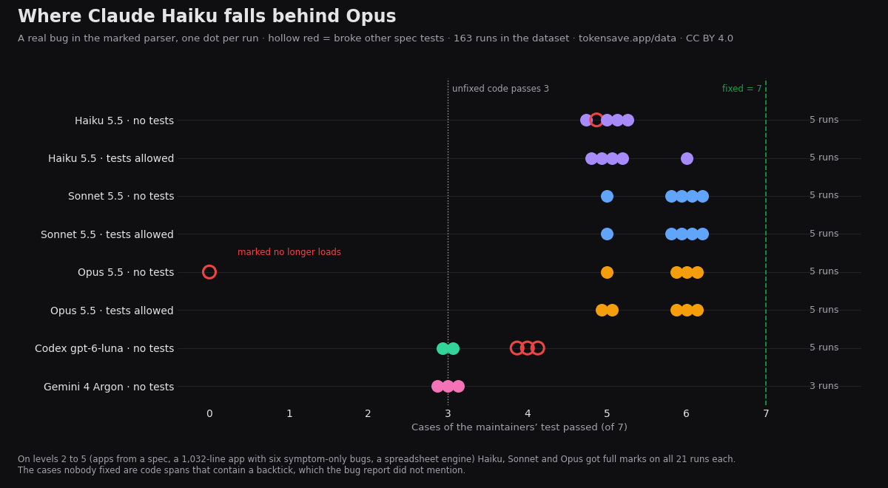

# Where AI coding agents first fail

136 headless runs (plus 6 excluded) of Claude Code (Haiku 5.5, Sonnet 5.5, Opus 5.5), Codex (gpt-6-luna) and Antigravity CLI (Gemini 4 Argon) on six levels of coding tasks, measured 2026-10-23 to 24 on one Windows 11 laptop.

Page, tables and method: https://tokensave.app/data/ai-coding-limit-line · DOI [10.5281/zenodo.23600477](https://doi.org/10.5281/zenodo.23600477) · License: CC BY 4.0

## Key findings

- Levels 2 to 5 (apps from a spec, and an existing 1,032-line app with six symptom-only bugs plus three features): Haiku, Sonnet and Opus got full marks on all 21 runs each, Gemini 18/18, Codex 17/20.
- Level 6, three real bugs fixed in the [marked](https://github.com/markedjs/marked) Markdown parser in Sep to Oct 2026: the easy and medium bugs were solved by almost every run. On the hard one, no run passed the upstream test (7 cases): Opus and Sonnet 6, Haiku 5 (one run broke 15 other spec tests), Codex and Gemini 3 (the same as the unfixed code).
- Average API cost per run (Claude Code's own figure): Haiku $0.027, Sonnet $0.20, Opus $0.44.

## Files

- `ai-coding-limit-line.csv` / `.json`: one row per run (score, full marks, seconds, tokens, cost, notes; level 5 and 6 detail columns). `excluded` marks runs stopped by the harness or by quota.
- `prompts/`: every prompt (tier2 to tier5b, tier6_t1 to t3).
- `checkers/`: the hidden-test checkers (Playwright, Python) and the tier-6 scorer. `ref/`, `tier5a/`, `tier5b/`: reference solutions, the planted-bug base app and broken variants used to validate the checkers.
- `results/`: raw checker output per level.
- `runs/<tool>_t<level>_r<n>/`: each run's log (`run.jsonl` or `run.json`), `seconds.txt` and the code it produced (`work/`; for level 6 only `work/src`). The PC user name is replaced by USER.
- `build_dataset.py`: builds the CSV/JSON from the results and logs.

## Notes

- Level 6 scoring: a clean checkout of the commit before the upstream fix plus only the run's `src/`, the upstream fix's spec file added, then marked's spec suite. 1 point if the hidden spec passes and no other spec test newly fails.
- Antigravity's headless mode ends a turn at the first denied command. Gemini runs used read-only allow-rules; the level 6 runs were repeated with full permissions (`geminifull_*`, run by the owner).
- Few runs per cell at the higher levels (1 to 5); see the page for all limitations.
